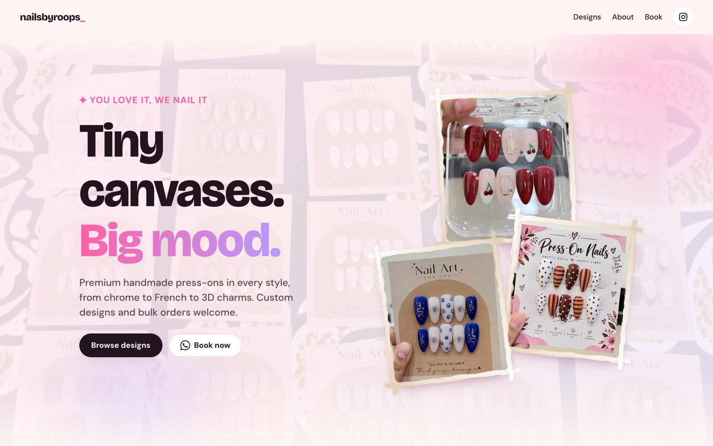
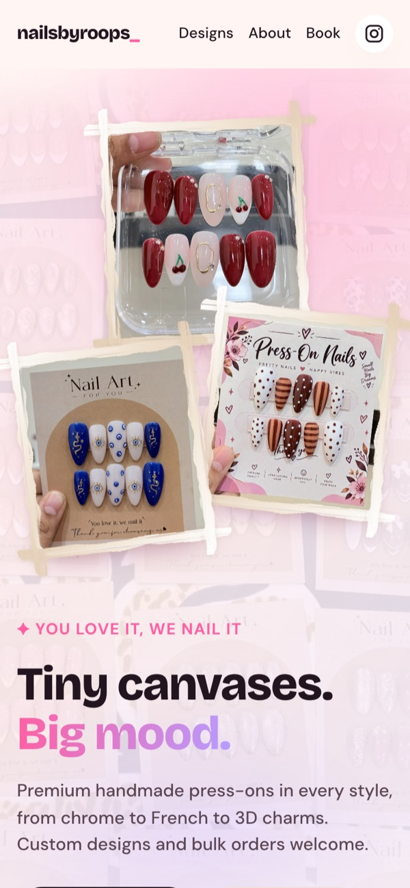
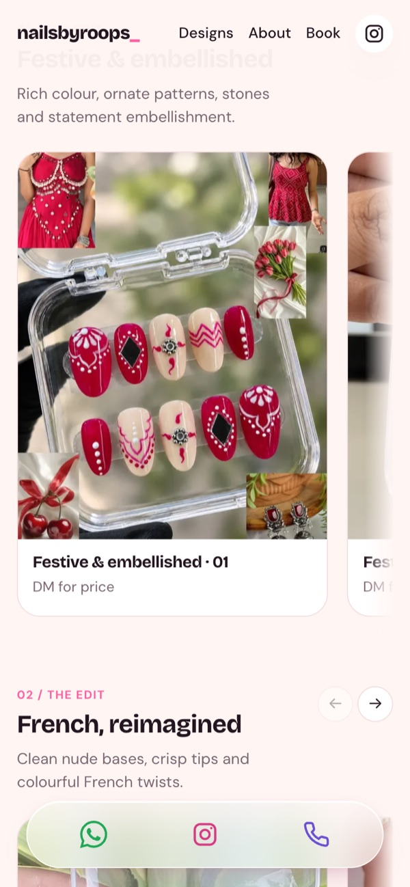
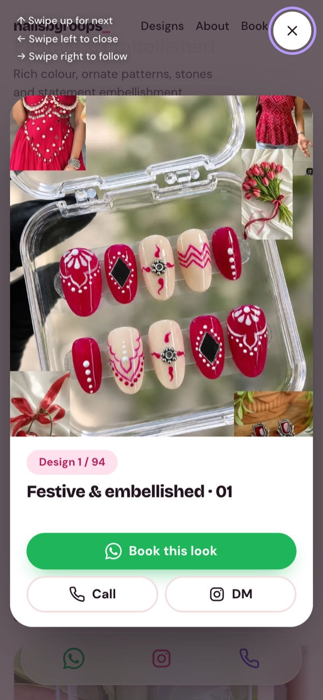
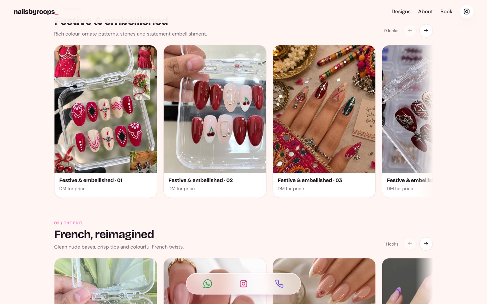
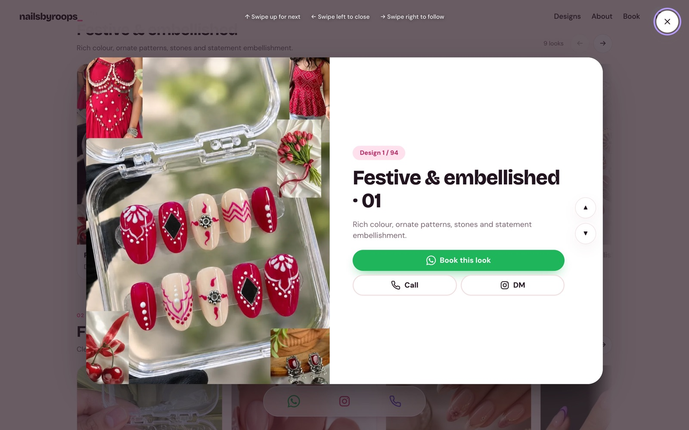
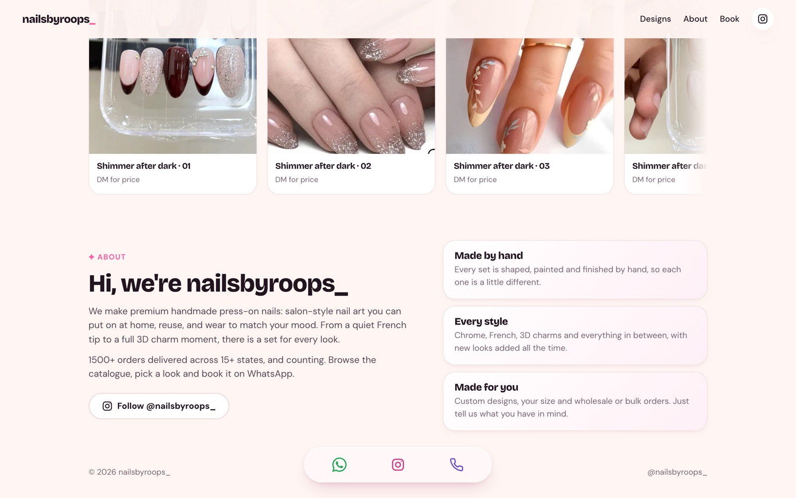

<div align="center">

# nailsbyroops_

### Tiny canvases. Big mood.

A fast, pastel-pretty catalogue for **nailsbyroops_**: premium handmade press-on nails.
Browse every look, flick through them reel-style, and book on WhatsApp in one tap.




</div>

---

## About

**nailsbyroops_** makes premium handmade press-on nails: salon-style nail art you can put on at home, reuse, and wear to
match your mood. From a quiet French tip to a full 3D-charm moment, there is a set for every look. Custom designs and
wholesale / bulk orders are always welcome, and over **1500 orders** have been delivered across **15+ states**.

This repository is the website: a mobile-first catalogue where customers browse collections, tap a look, and book
it straight on WhatsApp (the message already names the design and links to its photo). There is also an **About** section
on the page itself (`frontend/src/components/About.jsx`).

Find the brand on Instagram: [@nailsbyroops_](https://instagram.com/nailsbyroops_)

## Highlights

- **Collage hero**: three tilted photos with white-and-beige dry-brush strokes over their borders, on a soft pastel wash.
- **Collections you can scroll**: every style (chrome, French, 3D charms, festive...) is a horizontal rail with edge fades and arrow controls.
- **Reel-style viewer**: tap any photo to open a centered card that loops through *all* designs.
  Swipe up for next, down for previous. On desktop use a trackpad two-finger scroll, the mouse wheel or drag, the ▲▼
  buttons or the arrow keys (Esc or ✕ closes). The card follows your fingers, quick flicks commit instantly and neighbouring photos are preloaded.
- **Book this look**: opens WhatsApp with the design name and a link to its photo.
- **Floating contact pill**: frosted glass with WhatsApp, Instagram and Call. It appears once you scroll; Call opens both numbers (tap to call, or copy).
- **Shareable links**: every design has its own URL (`/#/d/<id>`).
- **Always online**: designs and photos come from Supabase, with a bundled copy as a fallback so the page never goes blank.

## Screenshots

<table>
  <tr>
    <td align="center"><br /><sub>Landing</sub></td>
    <td align="center"><br /><sub>Catalogue + contact pill</sub></td>
    <td align="center"><br /><sub>Reel viewer</sub></td>
  </tr>
</table>







## How it's put together

Production is just two things:

| Piece | What it does | Where |
|---|---|---|
| `frontend/` | The website (React + Vite). Reads designs straight from Supabase with the public, read-only key. | **Vercel** |
| Supabase | Database (collections, designs) and public photo storage. | **Supabase** |

`backend/` (FastAPI) is optional and **not used by the live site**. It stays in the repo as a ready-made API
(`/api/catalogue`) in case you want one later. The Supabase tables and `schema.sql` are shared with it.

```
.
├── frontend/            React + Vite site
│   ├── src/
│   │   ├── App.jsx            page layout, routing by #hash
│   │   ├── site.js            contact details and homepage numbers
│   │   ├── catalogue.json     bundled fallback catalogue
│   │   ├── supabase.js        fetches collections + designs
│   │   ├── admin/             /admin page: login, draft editor, review & publish
│   │   └── components/        About, ContactPill, DesignModal (reel), StyleGallery, ...
│   ├── public/hero/           landing photos
│   ├── public/photos/         thumbs/ (cards) and view/ (viewer) WebP images
│   └── photos-src/            original photos (not shipped)
├── backend/             optional FastAPI + Supabase schema
├── scripts/             image pipeline and Supabase import
└── docs/screenshots/    images used in this README
```

## Run locally

```bash
cd frontend
npm install
cp .env.example .env.local   # then fill in the two Supabase values (see below)
npm run dev                  # http://localhost:5173
```

Without the Supabase values the site still works: it shows the copy bundled in `frontend/src/catalogue.json`.

## Change your details

Phone numbers, Instagram, the WhatsApp number and the homepage numbers (designs / orders / states) live in
`frontend/src/site.js`. WhatsApp links assume India (`91`). Edit the file and redeploy. The About section reads the
brand name, Instagram and the order / state counts from the same file.

## Photo catalogue

`frontend/src/catalogue.json` defines collection names (their order in the file is the order on the page), descriptions,
photo order and stable shareable IDs. The original photos live in `frontend/photos-src/` (not shipped to the website).
`scripts/make_images.py` turns each one into two **WebP** images of identical size, with plain white/black borders trimmed
and the crop centred on the nails: `frontend/public/photos/thumbs/` (600x750, catalogue cards) and `photos/view/`
(1000x1250, the viewer and the photo link sent on WhatsApp). Each entry in the catalogue also stores an individual crop
rectangle and exposure multiplier, which the script applies. After adding or editing photos run:

```bash
pip install pillow numpy
python3 scripts/make_images.py
```

`scripts/photo-source-index.json` maps imported filenames and records excluded promotional collages and repeated looks.

The hero uses a flat-lay photo as a faded pink background (`frontend/public/hero/bg-cards.webp`) with three real product
photos in a tilted collage (`photo-*.webp`). Swap those files to change them.

"Book this look" opens WhatsApp with a message naming the design plus the link to its photo (`/photos/view/...`).
WhatsApp links cannot attach a file, so the photo shows as a preview in the chat once the site is live on a public URL
(it won't preview from localhost).

## Supabase (designs and photos)

One-time setup:

1. Supabase -> **SQL Editor** -> run `backend/supabase/schema.sql` (tables, read-only public access, photo bucket).
2. Put `SUPABASE_URL` and `SUPABASE_SECRET_KEY` in `backend/.env` (git-ignored; the secret key is only for the import
   script on your machine, never on Vercel, never committed).
3. `backend/.venv/bin/python scripts/import_to_supabase.py` uploads the photos and fills the tables.

Day to day, edit rows in **Table Editor** (`designs`: title, description, price, tags, `featured`, `sort_order`;
`collections`: order and descriptions). Changes show on the site the next time a page loads. To add a new design, run
`scripts/make_images.py`, then `scripts/import_to_supabase.py` (uploads the WebP files and updates the rows).

## Admin page (`/admin`)

`https://<your-site>/admin` lets the owner add and remove photos, rename section headings and drag to reorder
(hold and drag a section's handle, or a photo). It lives in the same Vercel project (a separate chunk, so visitors
never download it).

**Nothing autosaves.** Edits only change a draft on screen. **Review & publish** lists exactly what will change
(adds, renames, reorders, deletions) and nothing goes live until you press **Publish now**. **Discard** throws the
draft away, and the browser warns before you leave with unpublished changes. Once published, the live site shows the
changes on its next page load.

**How it's protected:** sign in with an ID and password (Supabase Auth; "admin" is stored as `admin@nailsbyroops.admin`).
The database rules (`backend/supabase/admin.sql`) allow writes only for emails on the `admin_emails` table, so finding
`/admin` or the public key isn't enough to change anything. Use **Change password** in the page after your first sign-in.

One-time setup:

1. Run `backend/supabase/admin.sql` in the Supabase SQL Editor.
2. Create the admin user (Authentication -> Users -> Add user, tick *Auto Confirm User*) and add its email to the
   `admin_emails` table. Optional but wise: Authentication -> Sign In / Providers -> turn off *Allow new users to sign up*.

New photos are cropped to the standard 4:5 in the browser (plain borders trimmed, drag to adjust, slider to zoom) and
uploaded as WebP when you publish. A section can only be deleted when it is empty.

## Deploy (one Vercel project)

Import the GitHub repo in Vercel with **Root Directory `frontend`** (framework: Vite). Add two environment variables
(Settings -> Environment Variables), then deploy:

| Name | Value (from Supabase -> Project Settings -> API Keys) |
|---|---|
| `VITE_SUPABASE_URL` | your project URL, `https://<project-ref>.supabase.co` |
| `VITE_SUPABASE_PUBLISHABLE_KEY` | the **publishable** key (`sb_publishable_...`) |

Both are public by design: the key can only read, because row-level security allows nothing else. **Never** put
the secret key in Vercel or in any `VITE_` variable (those end up in the website's code). Changing a variable
needs a redeploy.

---

<div align="center">

Made with 💅 for [@nailsbyroops_](https://instagram.com/nailsbyroops_)

</div>
